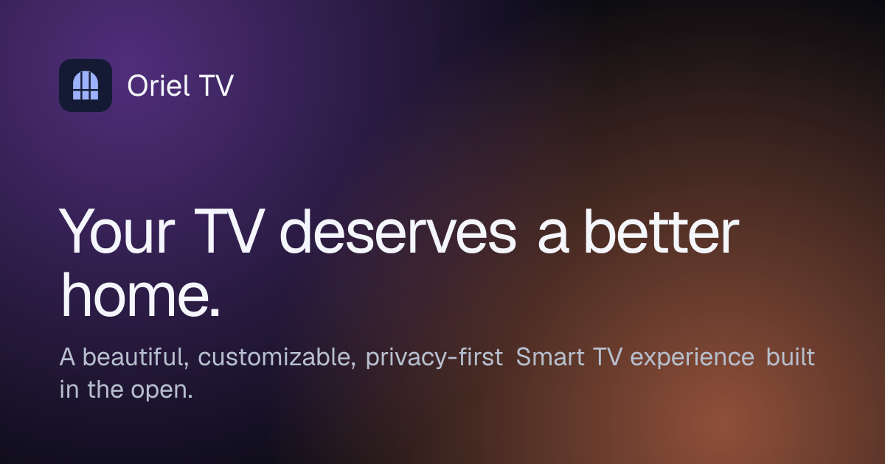
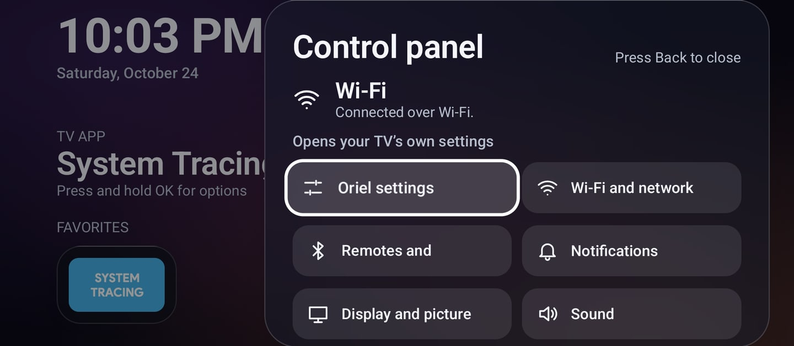
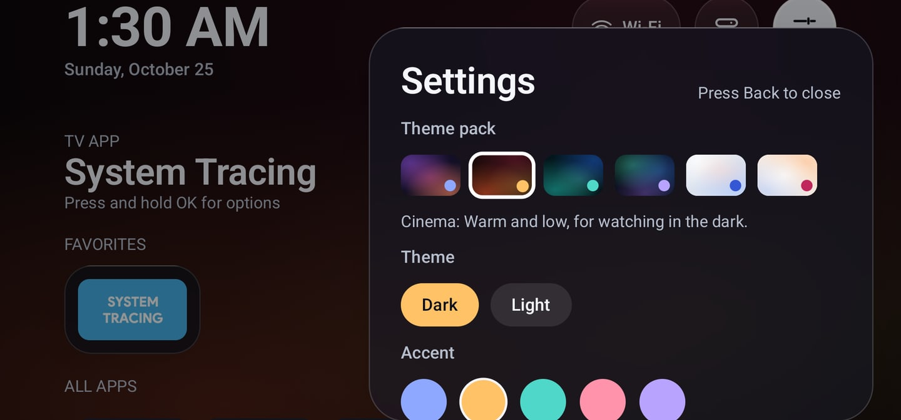

<p align="center">
  
</p>

<p align="center">
  <a href="https://github.com/vishwavinoth/oriel-tv/releases/latest"></a>
  <a href="https://github.com/vishwavinoth/oriel-tv/actions/workflows/ci.yml"></a>
  <a href="LICENSE"></a>
</p>

<p align="center">
  <a href="https://oriel-tv.vercel.app/demo/"><b>Try the live demo</b></a> ·
  <a href="https://github.com/vishwavinoth/oriel-tv/releases/latest">Download</a> ·
  <a href="docs/guides/getting-started.md">Get started</a> ·
  <a href="#help-test-and-build-oriel">Contribute</a>
</p>

# Oriel TV

**Your TV. Your atmosphere.** Oriel is an open-source, privacy-first home screen for Android TV and Google TV. It has a calm, glass-inspired design built for the remote, and a desktop companion that sets it up safely.

> **Public preview (0.1.0).** Oriel is ready to try, but nobody has tested it on a physical TV yet, only in the Android emulator. If you have an Android TV or Google TV, [a device report](https://github.com/vishwavinoth/oriel-tv/issues/new?template=device_report.yml) is the most useful thing you can give the project right now, including when something doesn't work.

| The control panel | Theme packs |
| --- | --- |
|  |  |

<sub>Screenshots from the Android emulator.</sub>

## What it does

**On your TV: Oriel Launcher**

- A home screen with a clock, a favorites dock, and every app in one grid.
- D-pad navigation that stops at the edges and keeps your place when you come back.
- Favorites, reordering, and hiding apps, from an options menu on any app.
- A control panel with your connection status and shortcuts to the TV's own Wi-Fi, Bluetooth, notifications, display, and sound settings.
- Six theme packs, light and dark themes, accent colors, and wallpapers, plus Reduce motion and Reduce transparency.
- Android 5.0 and newer, with draft translations into Spanish, French, German, Hindi, Tamil, and Arabic.
- No internet permission, and no accounts, ads, or analytics.

**On your computer: Oriel Control Center**

- Uses your own adb to install Oriel, make it the home app, and turn the built-in home screen off and back on.
- Explains every change, its risks, and its exact commands before you confirm, and backs up what it turns off.
- For Windows, Linux, and Apple silicon Macs.

**What Oriel won't do:** remove ads inside streaming apps (those belong to the apps), uninstall anything, or ask for root.

## Get started

1. Download `oriel-launcher-0.1.0.apk` from the [latest release](https://github.com/vishwavinoth/oriel-tv/releases/latest).
2. Install it with `adb install`, following [Getting started](docs/guides/getting-started.md), or with Control Center.
3. Open **Oriel** from your TV's list of apps.

Check the [compatibility list](https://oriel-tv.vercel.app/devices/) for your platform first. On Fire TV, Oriel installs but can't be the home screen.

## Help test and build Oriel

| You can | How |
| --- | --- |
| Test it on your TV | [Send a device report](https://github.com/vishwavinoth/oriel-tv/issues/new?template=device_report.yml) of what worked and what didn't. Reports go on the website's compatibility list. |
| Review a translation | Native speakers of Spanish, French, German, Hindi, Tamil, or Arabic: see [Review or add a translation](CONTRIBUTING.md#review-or-add-a-translation). |
| Design a theme pack | A theme, an accent, and a wallpaper in one step: see [Submit a theme pack](CONTRIBUTING.md#submit-a-theme-pack). |
| Report a bug | [Open a bug report](https://github.com/vishwavinoth/oriel-tv/issues/new?template=bug_report.yml). |
| Write code or docs | Kotlin with Compose for TV, Compose Multiplatform, or Next.js. Start with [CONTRIBUTING.md](CONTRIBUTING.md). |

## How it's built

| Part | Folder | Built with |
| --- | --- | --- |
| Launcher | `launcher/` | Kotlin and Jetpack Compose for TV |
| Control Center | `control-center/` | Kotlin and Compose Multiplatform |
| Device-safety core | `shared/device/` | Kotlin: the command allowlist, validation, and backup format |
| Design tokens | `shared/design-tokens/` | One source of colors, materials, and wallpapers, with contrast tests |
| Website | `website/` | Next.js, React, and Tailwind CSS, exported as a static site |

```bash
# Launcher: JDK 17+ and the Android SDK (platform 36)
./gradlew :launcher:assembleDebug :launcher:testDebugUnitTest

# Control Center
./gradlew :control-center:run

# Website: Node.js 20.9+
cd website && npm ci && npm run dev

# Design tokens, from the repository root
npm run tokens && npm run test:tokens
```

## Documentation

- [Getting started](docs/guides/getting-started.md), [Device management](docs/guides/device-management.md), and [Troubleshooting](docs/guides/troubleshooting.md)
- [Product requirements](PRD.md), [design system](docs/design-system.md), [architecture decisions](docs/adr/), and [releasing](docs/releasing.md)
- [Contributing](CONTRIBUTING.md), [Security](SECURITY.md), [Privacy](PRIVACY.md), and [Changelog](CHANGELOG.md)

## License

Copyright 2026 Vishwa R and the Oriel TV contributors. Licensed under the [Apache License 2.0](LICENSE). The license doesn't grant rights to use the Oriel name or logo; see [TRADEMARKS.md](TRADEMARKS.md).

<sub>Beautiful by design. Open by nature.</sub>
